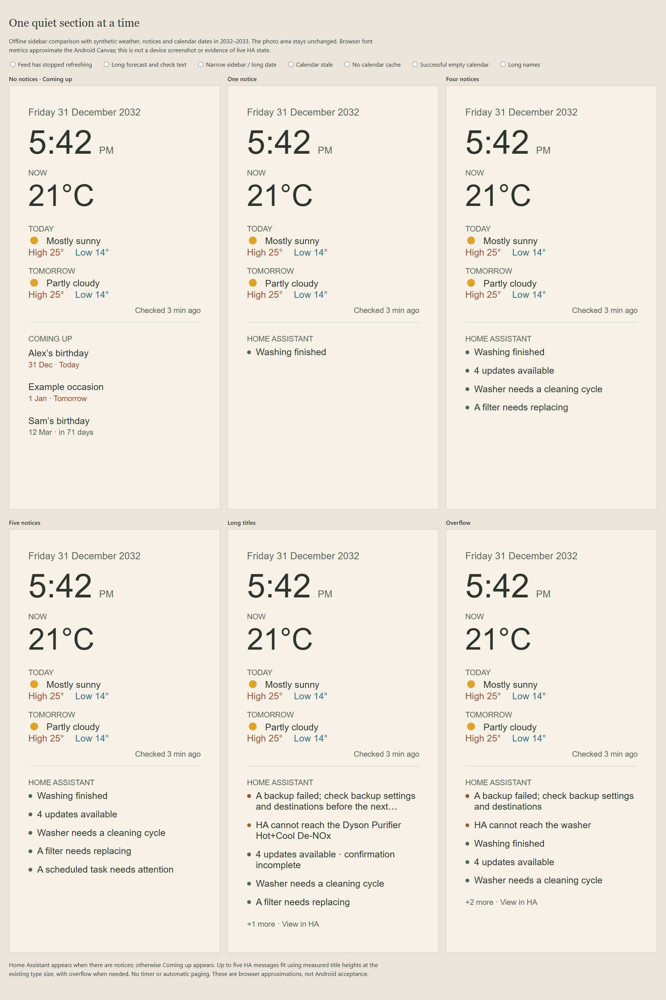

# Calendar sidebar candidate

**Parked by the user on 15 November 2026 until more physical to-do tasks progress.**
No automatic resumption, account setup, deployment or merge. Start with the
[current TODO status and new-chat resume instructions](TODO.md) when returning.
Last tested runtime: `abfed948bdfa332e99a7dd5d5b03bc5d2308829a`; 53 host tests,
343 JVM assertions and [CI run 43653319559](https://github.com/lachlanw-117/Bravia-Ambient-Display/actions/runs/43653319559)
passed. Subsequent documentation-only commits preserve this runtime identity.

Status: implemented locally, **not deployed; no device acceptance**. Work starts
from PR #8's head `0c7ce4518c0857fa9d4f1d24ad61925bb5f89d55` on
`feature/calendar-sidebar`. The draft PR targets `feature/household-alerts`, so its
diff contains the calendar work only. Neither that branch nor PR #8 is modified
or merged. If the notice candidate changes, review compatibility before rebasing
or retargeting. The unrelated untracked `HOME_SCREEN_ADS.md` is preserved.

## Repository ownership and calendar interface

The private `wright-family-calendar` repository owns source dates, nicknames,
milestone calculations, user-approved occurrence subjects, publishing ten years
ahead, ongoing maintenance and copying selected events to work/client calendars.
Bravia owns reading that published Outlook calendar and displaying it in the
existing screensaver. It does not seed events, infer recurrence, calculate ages
or anniversary years, substitute names, write to calendars, maintain publication
or send phone push alerts. These responsibilities replace the earlier brief's
Bravia-side age option and series-creation setup notes.

The publisher-facing interface is one dedicated personal Outlook calendar:

| Published Outlook field | Bravia contract |
| --- | --- |
| `subject` | User-approved display text, copied verbatim into `title`. Bravia does not trim, rename, append milestones or classify it. |
| `isAllDay` | `true` for this civil-date occasions interface. Timed appointments are outside this interface and fail validation. |
| `start` | Included start at midnight in Australia/Sydney (Graph's `AUS Eastern Standard Time`). |
| `end` | Exclusive end at midnight in the same timezone; may be multiple days after start. |
| `id` / cancellation | Identity becomes an opaque hash; cancelled occurrences are omitted. Full snapshots replace edits/deletes. |

The publishing repository is responsible for what the approved subject discloses.
Bravia passes it through, including any publisher-approved nickname, age, milestone
or year in that subject. Descriptions, source dates of birth, owners, attendees and
locations are not requested or interpreted. Blank/control-character/oversized
subjects fail the refresh rather than being rewritten; the limit is 1,024 UTF-16
code units. Display fitting may ellipsise long text; accessibility retains the
complete subject. No real family payload is committed in this repository.

The host adds authenticated read-only `GET /calendar` using the existing bearer
key and `Cache-Control: no-store`. Calendar refresh runs at startup and every
30 minutes independently of photos, weather and notices. The TV reads on entry
and every five minutes and cancels requests on exit. All Outlook authentication
and refresh-token renewal remain within this agreed display integration, using
only delegated `Calendars.ReadBasic` plus `offline_access`. There is no body-read
or optional wider calendar permission.

The public snapshot is `{schemaVersion: 2, fetchedAt, timezone:
"Australia/Sydney", stale, occurrences}`. Each occurrence contains only opaque
`occurrenceId`, exact published `title`, included `localDate`, exclusive
`endDateExclusive` and recomputed non-negative `daysUntil`. There is no inferred
kind or display-age field. Version 1 host/TV caches are intentionally discarded:
they may contain trimmed subjects or locally calculated ages. No migration can
reconstruct an exact original subject. A new valid read is required; other caches
and settings are unaffected.

For example, a synthetic all-day start of 30 December 2032 and exclusive end of
3 January 2033 displays **30 Dec 2032–2 Jan 2033**. It remains visible throughout
2 January, shows **Underway** after its start day, and expires at Sydney midnight
starting 3 January even offline. Single-day end dates are never displayed as an
extra day. Today, Tomorrow and in N days describe future starts; the TV computes
them locally on midnight/resume. No milestone arithmetic occurs in Bravia.

Bravia queries a padded 400-day Graph calendarView, including overlapping events
that started before the query window. The TV/public view shows underway events
plus starts through the same date next year (leap-day horizon clamps to February
28), sorted by start date then opaque ID. The ten-year publication horizon belongs
to `wright-family-calendar`; Bravia does not fetch ten years, generate missing
occurrences or extend an expired publication. Up to three calendar rows display.
Duplicate page overlap deduplicates; conflicting rows or any failed later page
leave the prior complete snapshot unchanged.

The lower sidebar shows one section at a time: **Home Assistant** when the visible
notice list has entries, otherwise **Coming up**. Up to five HA messages use actual
Android text heights at the existing readable type size, with two-line wrapping,
severity ordering and overflow. Short titles take less vertical space than long
titles. Stale retained notices keep HA visible; event expiry and a valid empty
snapshot allow Coming up to return. An empty but unavailable/stale HA feed leaves
a quiet status line beside the calendar rather than implying household health.
This replaces the first candidate's simultaneous notices/calendar layout following
user feedback on 15 November 2026. The one-minute carousel remains a proposal;
there is no timer, automatic paging or new remote gesture. Important notices
should remain visible if a carousel is considered later.

Calendar Today/Tomorrow use the existing warm accent. Long titles/details
ellipsise. No calendar cache says “Calendar unavailable”; a successful empty
snapshot says “No upcoming occasions”. After 24 hours without success, show
“Calendar may be out of date”. Future fetch times are uncertain immediately.
Stale rows remain available until their exclusive end date, even offline. If no safe
row/status fits, the calendar block is temporarily hidden.

Host persistence is `DATA_DIR/calendar.json` (installed default
`/data/cache/calendar.json`), independent of other caches. A source fingerprint
includes the schema version, client and dedicated calendar ID, so a different
source cannot relabel a host cache. Android atomically stores a bounded 64 KiB
snapshot in app-private `ambient/calendar.json`, scoped to the host address.
An unavailable host does not erase a valid v2 cache. Changing host address clears
that host's snapshot. Photos, weather and notices keep their separate caches.

## Provider choice and connection still required

The personal Outlook connection mentioned in the private brief is not a runtime
credential for this application. No account, calendar or event was changed.
No family dates or credentials are included in source, tests or previews.

The maintained [MS365 Calendar integration](https://rogerselwyn.github.io/MS365-Calendar/)
was evaluated first. Its
[range coordinator](https://github.com/RogerSelwyn/MS365-Calendar/blob/main/custom_components/ms365_calendar/integration/coordinator_integration.py)
can fall back to cached results after an out-of-range Graph request fails.
The normal HA REST calendar response does not prove that the full requested range
was refreshed. That cannot establish this feature's empty/error distinction.
The candidate therefore uses the brief's narrow direct-Graph fallback. It does
not install or reconfigure HA, and does not use an anonymous ICS publication.

[Graph calendarView](https://learn.microsoft.com/en-us/graph/api/calendar-list-calendarview?view=graph-rest-1.0)
supports delegated `Calendars.ReadBasic` for personal accounts and returns expanded
occurrences/exceptions. The adapter only GETs
`https://graph.microsoft.com/v1.0/me/calendars/{configured-id}/calendarView`.
It follows next links only on that exact HTTPS origin and calendar route, rejects
redirects, loops, more than ten pages, over 256 records, over 256 KiB per page or
over 60,000 bytes sanitised. A later-page error, permission failure, invalid row
or disk failure leaves the prior snapshot unchanged. All-day response dates must
be midnight in Sydney / `AUS Eastern Standard Time`; mismatches fail rather than
silently shifting a published date. Logs contain a fixed failure message only.

The [personal-account device flow](https://learn.microsoft.com/en-us/entra/identity-platform/v2-oauth2-device-code)
helper and refresh adapter use the fixed Microsoft `consumers` authority. The
runtime never creates or edits events. Access tokens stay in memory; only the
rotating refresh token and client ID are atomically stored in a private file
(mode 0600 on POSIX, newly created directory 0700). A refresh commits its rotated
token before returning access. Concurrent callers share one renewal. Windows
operators must protect the directory with a user-only ACL; POSIX permissions
cannot enforce Windows ACLs. Do not put tokens in add-on options, Git, chat or
command arguments. Missing/revoked access leaves the display cache intact.

Remaining setup, in order:

1. Coordinate with the private `wright-family-calendar` repository to identify
   the published dedicated calendar, verified personal owner and exact calendar
   ID. That repository owns creating/populating/maintaining the published ten-year
   occurrences. Bravia setup must not seed or copy events. Do not select a
   work/client calendar or the built-in Birthday calendar.
2. Create an Entra application registration supporting personal Microsoft
   accounts and enable public client/device flows. Use delegated
   `Calendars.ReadBasic` and `offline_access`; no client secret, write permission
   or application-wide unattended permission is needed for the display.
3. On a private Node 22+ workstation/host checkout, set `OUTLOOK_CLIENT_ID` to the
   registration ID and `OUTLOOK_TOKEN_FILE` to an **absolute path outside source**
   in a private directory. Run `node tools/connect-outlook-calendar.mjs` manually
   when ready to consent. The helper displays only a short-lived user code.
   Complete sign-in at Microsoft's device-login page with the verified personal
   account. It writes the refresh token without displaying it. This helper has
   been tested with synthetic responses only; real consent is outstanding.
4. Set `OUTLOOK_CALENDAR_ID` for standalone operation, or `outlook_calendar_id` in
   the proposed add-on configuration; similarly `OUTLOOK_CLIENT_ID` or
   `outlook_client_id`. Blank calendar ID leaves the feed unavailable and makes no
   Graph requests. Keep the normal weather/notice HA configuration unchanged.
   The proposed add-on expects its private token at `/data/cache/outlook-token.json`;
   standalone operation can override this with `OUTLOOK_TOKEN_FILE`. Secure token
   provisioning to that runtime path requires the separately approved host trial.
5. Before adopting the provider on Pi, compare its full 400-day result with
   Outlook: expanded recurrence, exceptions/cancellation, same-day events, Sydney
   multi-day inclusive/exclusive boundaries, exact subjects, pagination, edits/deletes,
   token renewal and failure recovery.
   Do this privately; record counts/results and revision, never family payloads.

## Local validation and preview

- `npm.cmd test`: **53 tests pass**, including Graph pagination/security bounds,
  exact-subject, multi-day date/cache/error cases, OAuth renewal and device-flow cases, and all
  existing photo/weather/notice regressions. All dates and tokens are synthetic.
- `tools/build-android.ps1 -Tools EXISTING_PRIVATE_TOOLCHAIN -Unsigned`: **343 JVM
  assertions pass** (15 policy, 208 photo, 25 weather, 34 notices, 61 calendar).
  Android resource/Java/DEX compilation and APK alignment pass without opening or
  using signing keys. Existing Java 8/deprecated fullscreen API warnings remain.
- `node tools/package-addon.mjs`, packaged calendar/auth syntax and host import
  checks pass. The package contains both new runtime modules.
- [Interactive synthetic preview](docs/calendar-comparison.html): normal and
  combined stale/long-weather/narrow/long-name cases rendered and visually checked
  in headless Edge. Zero/one/four/five/many notice cases show mutually exclusive sections, with
  measured wrapping and visible overflow. Empty/unavailable toggles are included.
  This uses browser font metrics, not Android graphics or a device screenshot.

Outputs are ignored: `build/android/wright-ambient-unsigned.apk`,
`build/bravia_ambient`, and `build/calendar-preview`. The unsigned APK must be
signed with the existing identity under deployment approval before installation.
The JVM checks cover the production map parser and presentation policy, not
Android's JSON bridge, AtomicFile storage or actual lifecycle cancellation.

## Required device acceptance and rollback

Keep the draft PR open. Local/CI success is not device acceptance. Obtain explicit
Pi/TV trial approval for the exact feature-branch revision before device actions.
Preserve the installed known-good host package/APK, private caches and settings;
verify drift and hashes. Build from that revision and record SHA/artifact hashes
in the trial record, without including tokens or snapshots in Git.

Outstanding acceptance:

- Actual personal Outlook consent, renewal after restart and authenticated
  Graph → host → TV path; successful empty versus failed/revoked access, failed
  later pages, persistence/restart and recovery.
- Sony sidebar at couch distance with long names/weather, zero/one/many notices,
  important notices, overflow and stale/unavailable wording. No clipped content,
  calendar competing with HA messages or changed photo bounds.
- Sydney midnight/DST/year rollover and resume while offline; past dates disappear,
  countdown changes, multi-day events remain through their final included date,
  freshness warning appears at 24 hours.
- Whole-photo/portrait pairs, transitions, saved continuation, weather freshness,
  notice changes/expiry and offline retention remain correct.
- Physical first-input/Back dismissal, ordinary idle entry/resume, streaming/HDMI
  behaviour and exit request cancellation. No wake, focus, acknowledgement or edit
  mode is added. Existing input-handler source is unchanged.

For rollback under separate approval, restore the preserved host package and
signed APK from before this calendar trial, preserving existing settings/photo,
weather and notice caches. The older runtime ignores calendar files/options;
remove/revoke the calendar token separately if retiring the connection. Never
restore a refresh token from an old backup over a newer rotated credential.
No deployment, restart, reload, HA change or merge was performed for this work.
