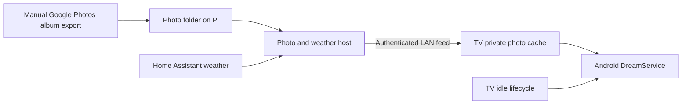

# Sony Bravia Ambient Display

A local-first family-photo screensaver for the Sony X90K Google TV.
The household trial uses a Pi photo/weather host and a 147-photo album. Cream
presentation, portrait pairs, Now/Today/Tomorrow weather and photo continuation
passed scoped household acceptance on 8 November 2026 and merged into main.
Debugging was disabled at closeout. These are historical results, not fresh live
inspection or complete streaming/HDMI/recovery coverage. See [trial results](TRIAL.md)
and the [11 November TV test](TV_TEST_2026-11-11.md) for current observations and
remaining checks. No reinstall is needed merely to resume.

Phase 2 and the weather/playback refinement were merged on 8 November 2026.
Recorded acceptance is complete for the scoped trial; broader outage and long-run
recovery testing remains outstanding. See merged [Phase 2 PR #3](https://github.com/lachlanw-117/Bravia-Ambient-Display/pull/3)
and [weather/playback PR #4](https://github.com/lachlanw-117/Bravia-Ambient-Display/pull/4).
Trial documents retain intermediate pending-approval notes as historical records;
those notes are superseded by these merges. This summary does not claim a fresh
device check.

On 14 November 2026, the user confirmed they are happy with the screensaver and
explicitly approved merging the 11 November home-style trial (PR #5).
This closes its household acceptance gate without claiming the detailed
forecast-low, failure/recovery or HDMI checks were independently observed.
The subsequent forecast-unit cache fix is source-tested but not deployed;
the last recorded installed runtime remains `29b3784f255ee7d29500a03c3166bae05248342d`.

[](https://github.com/lachlanw-117/Bravia-Ambient-Display/actions/workflows/checks.yml)

The [implementation roadmap](ROADMAP.md) separates the accepted enhancements into
individually authorised phases. [Decisions](DECISIONS.md) preserve the reasons and
deferred alternatives; [maintenance](MAINTENANCE.md) covers acceptance, rollback
and debugging cleanup. Phase 0 records that plan; it does not deploy enhancements.
The [development workflow](CONTRIBUTING.md) describes short-lived branches, PR
checks and the separation between reviewed source and actual deployment.

## Design



The TV runs a native Android DreamService, not a browser launched by an HA timer.
Android owns idle entry and exit. There is no boot receiver, accessibility service,
foreground watchdog, wake lock, HDMI switching or remote-control API.
Any remote input dismisses the MVP; Home and power remain system-owned.
That reduces the risk of interrupting playback, but actual Sony firmware and
streaming/HDMI behaviour still need acceptance testing.

The Pi hosts a small Node 22 service, packaged as a local Home Assistant app/add-on
for HA OS. It scans one manually maintained folder every five minutes. The TV
refreshes on screensaver entry and every five minutes while running, keeping its
last complete album if downloads fail. Both caches survive process restarts.
No additional always-on computer is needed.

The slideshow fits complete photos without cropping, pairs consecutive portraits
when enabled and remembers progress across sessions in fixed album order. A cream
sidebar shows time/date, Now temperature, Today/Tomorrow forecast conditions and
ranges, and check age above space reserved for future notices. Missing forecast
values remain explicit. Slide duration is configurable from 10 to 300 seconds,
with a 30-second source default and 60-second household preference. Decoding and
prefetch are bounded; see [Phase 2](PHASE2.md) for rendering and performance limits.

The initial deployment used `weather.forecast_home`; the accepted deployment
selects the installed BOM daily source, using `Australia/Sydney`.
The adapter reads its state and requests daily forecasts
through `weather.get_forecasts`. It chooses today's entry by local date, never
substitutes tomorrow and retains date-matched forecast data on partial failure.
Today and Tomorrow use separate rows; freshness uses check age with specific
delayed-check wording. [Phase 1](PHASE1.md) records the selected BOM
source, offset-free local forecast dates and provider-isolated caching. Provider
attribution remains in the feed; the user requested no visible TV credit during
review. That final version passed scoped TV acceptance/closeout; merge approval
was supplied and Phase 1 merged. Missing values stay unavailable. Midnight removes
yesterday's high/low. These are the only HA operations in the host; it is not an
arbitrary service proxy. The live host and TV weather path passed the photo-free
trial on 7 November 2026; see [the recorded readings](TRIAL.md).

## Google Photos decision

The [2025 Library API changes](https://developers.google.com/photos/support/updates)
restrict listing and retrieval to app-created content. They do not provide
unattended access to an existing family album maintained in Google Photos.

| Approach | Suitability |
|---|---|
| Manual album download/export to the Pi | Selected MVP; no Google credentials or expiring URLs in the app |
| Picker API | Supported interactive selection, not a continuing subscription to album additions |
| Library API | App-created content restriction; also has short-lived caching guidance |
| Ambient API | Intended for ambient devices, but requires acceptance into Google's partner program |
| Shared-album scraping or browser-cookie sync | Excluded: brittle, additional credential handling and maintenance |
| Built-in Google TV Ambient mode | Worth retaining as rollback; custom overlay and reliable local cache are not under this project's control |

The [Picker session flow](https://developers.google.com/photos/picker/guides/sessions)
requires selection by the user. Google now documents an
[Ambient API](https://developers.google.com/photos/partner-program/overview), but
partner access is not a dependency a personal MVP should assume. The Library API's
[caching guidance](https://developers.google.com/photos/overview/best-practices)
also makes it unsuitable for an indefinite offline cache. Persistent offline
storage is no longer a user requirement; the current implementation still caches
user-exported photos, and any storage redesign needs discussion first.
The implemented cache contains user-exported local files, with no Google API client.
Automatic syncing from Google Photos is therefore an explicit MVP limitation.

## Local build and tests

Run commands from the project root. Host tests need only Node 22 or later:

```sh
npm test
node tools/package-addon.mjs
```

On Windows, install portable Java and Android tools, then build:

```powershell
powershell -ExecutionPolicy Bypass -File tools/bootstrap-windows.ps1
powershell -ExecutionPolicy Bypass -File tools/build-android.ps1
```

Run these commands from this project directory. The bootstrap downloads Temurin 21 and Google's command-line tools, verifies their
SHA-256 checksums, and installs API 35/build-tools 35.0.0 after SDK licence acceptance.
Tools stay in ignored `.tools/`; no global Java or Android configuration is required.
The build runs JVM policy assertions, compiles Java/resources/DEX, creates a local
debug key and verifies the signed APK. It does not invoke ADB or connect to a TV.

Output: `build/android/wright-ambient-debug.apk`.
Local HA app package: `build/bravia_ambient/`.
The APK, debug signing material, runtime caches, credentials and family photos
are excluded from Git. Keep the local debug key if updating the same installation;
switching signing keys requires uninstalling, which removes the TV cache/settings.

## Installation — approval required

The TV APK has been installed and the screensaver is reported working. Pi-host
installation and live weather checks passed, followed by a 147-photo import and
user-confirmed playback; see [trial results](TRIAL.md). The instructions below
describe installation, not work that needs repeating to resume the trial.

1. Export the chosen Google Photos album to local files. Google documents
   [downloading photos](https://support.google.com/photos/answer/7652919).
   Copy JPEG, PNG or WebP images into `/share/bravia-ambient` on the Pi.
   HEIC, RAW and video are not supported; convert those before copying.
   The MVP limits one album to 250 photos, 8 MiB per photo and 256 MiB total.
   Source files are never deleted. Copy using a temporary extension and rename
   after completion; an empty folder does not clear a working cached album.
2. Copy the generated `build/bravia_ambient` directory into HA OS's
   local-app directory (`/local_apps/` in Terminal & SSH on HA OS 18.4; older
   instructions call it `/addons/`), reload the local inventory, and install it.
   Installation, starting the app and any reload need explicit approval.
3. Configure a random photo-host access key of at least 24 characters, weather
   entity and timezone through the app options. Keep the key out of chat/Git.
   The host uses the Supervisor-provided token for weather; the TV never receives
   that token. The app mounts `/share` read-only and keeps its own cache under `/data`.
4. Sideload the signed APK using an approved method. Enable debugging only with
   approval if needed. Open Wright Ambient, enter `http://PI_LAN_ADDRESS:8099`
   and the photo-host key, save, and use Preview. The native TV keyboard/D-pad
   supports setup. HTTP is permitted for trusted LAN addresses only; use HTTPS
   if a suitable reverse proxy already exists. Do not expose port 8099 to the internet.
   LAN HTTP does not encrypt the photos or access key.
5. Use Open TV screensaver settings and select Wright family photos if the
   firmware exposes it. If Sony hides that picker, inspect the OS version and
   available settings before proposing a reversible ADB selection change.
   Do not disable Google's Ambient system app or guess privileged settings.
6. Check all scenarios in the acceptance list below before enabling it routinely.

Idle timeout belongs to the TV's operating system, not the slideshow interval.
Sony documents that some Google TV versions do not expose a startup-time setting.
The setup button opens the system screensaver settings; the app deliberately does
not implement a competing inactivity timer or change sleep settings. A custom
idle delay is a firmware-dependent installation question, not a working app parameter.

To undo: select the original system screensaver, stop the photo-host app, and
uninstall Wright Ambient if desired. Source photographs remain untouched.
Clearing the TV app's data explicitly removes its cache and saved access key.

## Acceptance checks on the Sony TV

- Confirm idle entry from the launcher and the configurable timing available on
  this firmware. Idle entry must not launch over active playback or HDMI gaming.
- Test actual streaming apps, paused video, live TV, Xbox/HDMI, input switching,
  Home, Back, volume and power. Exit must be prompt; check whether the first remote
  press only dismisses the dream or also reaches the underlying application.
- Check landscape and portrait rotation, crossfade, readability and photo order.
  Android 28+ uses ImageDecoder for orientation; the API 26–27 fallback does not
  correct JPEG EXIF rotation. Verify the installed Sony Android version.
- Disconnect the host/network during playback; the TV must continue its last-good
  album. Restore networking and check refresh, changed photos and deleted photos.
- Restart the host and TV app. Test an incomplete download, corrupt photo,
  midnight/DST, missing weather and forecast failure.
- Account for roughly two album generations during a transactional update
  (up to 512 MiB on each host/TV cache), plus source files and decoded bitmaps.

## Planned enhancements

[Phase 2](PHASE2.md) records the design B photo/sidebar trial:
adaptive portrait pairs, complete-image fitting and a static cream background.
It is deployed on the TV; the user accepted the cream palette and debugging is
closed. The user confirmed ordinary idle/Back with debugging off. Phase 2 and the
subsequent weather/photo-resume PRs were separately approved and merged.

The accepted direction is design B with adaptive portrait pairs, BOM weather,
native HA notice controls and local TV notice hiding. Design C is a later
aircraft scene. These features are not implemented by the documentation phase.
See the [phase boundaries](ROADMAP.md#phase-boundaries-and-stopping-points).

Keep the system-owned dream lifecycle and a clear immediate exit path. Notice
interaction is planned for Phase 4 independently of aircraft work; it does not
require implementing an aviation view first. The host must not expose HA
credentials or an arbitrary device-control proxy. Calendar and photo metadata
remain outside the current roadmap.

## Research references

- [Android DreamService lifecycle and input](https://developer.android.com/reference/android/service/dreams/DreamService)
- [Sony screensaver behaviour](https://www.sony.com/electronics/support/articles/00173061)
- [HA weather forecasts](https://www.home-assistant.io/integrations/weather/)
- [HA app packaging](https://contributors.home-assistant.io/apps/reference/configuration/)

Research checked 7 November 2026. Individual Sony playback/HDMI scenarios remain
unverified. Live weather was checked separately; automated tests use local mock
data, not household photos.

## First trial without photos

Follow [the infrastructure trial](TRIAL.md) to test TV rendering and idle behaviour, then Pi connectivity and HA weather separately. Family photos are optional until those checks pass.

The [weather refinement](WEATHER_REFINEMENT.md) is deployed, accepted and merged:
observed temperature under Now, explicit Today/Tomorrow forecasts, quiet check-age
text and photo continuation. The [current test record](TV_TEST_2026-11-11.md)
preserves remaining acceptance work and deferred layout/Home-screen-ad priorities.
Notices are not implemented.
