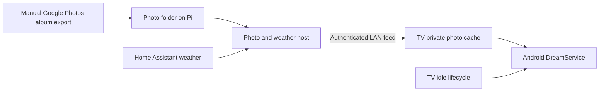

# Sony Bravia Ambient Display

A local-first family-photo screensaver for the Sony X90K Google TV.
This is an MVP under development. The APK builds and the local tests pass;
it has not been installed or tested on the TV.

## Design



The TV runs a native Android DreamService, not a browser launched by an HA timer.
Android owns idle entry and exit. There is no boot receiver, accessibility service,
foreground watchdog, wake lock, HDMI switching or remote-control API.
Any remote input dismisses the MVP; Home and power remain system-owned.
That reduces the risk of interrupting playback, but actual Sony firmware and
streaming/HDMI behaviour still need acceptance testing.

The Pi hosts a small Node 22 service, packaged as a local Home Assistant app/add-on
for HA OS. It scans one manually maintained folder every five minutes. The TV
refreshes on screensaver entry and every five minutes while running, keeping its
last complete album if downloads fail. Both caches survive process restarts.
No additional always-on computer is needed.

The slideshow uses a 30-second default and 1.5-second crossfade, fits each complete
photo without cropping, and displays time, date, current temperature/condition and
today's forecast high/low at bottom right. Slide duration is configurable from
10 to 300 seconds. Bitmaps are decoded to a maximum 1920 by 1080 bounding box to
limit TV memory use; the screen scales them to its resolution.

Weather comes from `weather.forecast_home`, confirmed present in this installation,
using `Australia/Sydney`. The adapter reads its state and requests daily forecasts
through `weather.get_forecasts`. It chooses today's entry by local date, never
substitutes tomorrow, retains same-day forecast data on partial failure, and
labels stale readings as cached. Missing values stay unavailable. Midnight removes
yesterday's high/low. These are the only HA operations in the host; it is not an
arbitrary service proxy. No HA calls from this application have run live yet.

## Google Photos decision

The [2025 Library API changes](https://developers.google.com/photos/support/updates)
restrict listing and retrieval to app-created content. They do not provide
unattended access to an existing family album maintained in Google Photos.

| Approach | Suitability |
|---|---|
| Manual album download/export to the Pi | Selected MVP; no Google credentials or expiring URLs in the app |
| Picker API | Supported interactive selection, not a continuing subscription to album additions |
| Library API | App-created content restriction; also has short-lived caching guidance |
| Ambient API | Intended for ambient devices, but requires acceptance into Google's partner program |
| Shared-album scraping or browser-cookie sync | Excluded: brittle, additional credential handling and maintenance |
| Built-in Google TV Ambient mode | Worth retaining as rollback; custom overlay and reliable local cache are not under this project's control |

The [Picker session flow](https://developers.google.com/photos/picker/guides/sessions)
requires selection by the user. Google now documents an
[Ambient API](https://developers.google.com/photos/partner-program/overview), but
partner access is not a dependency a personal MVP should assume. The Library API's
[caching guidance](https://developers.google.com/photos/overview/best-practices)
also makes it unsuitable for the indefinite offline cache wanted here.
The implemented cache contains user-exported local files, with no Google API client.
Automatic syncing from Google Photos is therefore an explicit MVP limitation.

## Local build and tests

Run commands from the project root. Host tests need only Node 22 or later:

```sh
npm test
node tools/package-addon.mjs
```

On Windows, install portable Java and Android tools, then build:

```powershell
powershell -ExecutionPolicy Bypass -File tools/bootstrap-windows.ps1
powershell -ExecutionPolicy Bypass -File tools/build-android.ps1
```

Run these commands from this project directory. The bootstrap downloads Temurin 21 and Google's command-line tools, verifies their
SHA-256 checksums, and installs API 35/build-tools 35.0.0 after SDK licence acceptance.
Tools stay in ignored `.tools/`; no global Java or Android configuration is required.
The build runs JVM policy assertions, compiles Java/resources/DEX, creates a local
debug key and verifies the signed APK. It does not invoke ADB or connect to a TV.

Output: `build/android/wright-ambient-debug.apk`.
Local HA app package: `build/bravia_ambient/`.
The APK, debug signing material, runtime caches, credentials and family photos
are excluded from Git. Keep the local debug key if updating the same installation;
switching signing keys requires uninstalling, which removes the TV cache/settings.

## Installation — approval required

None of these deployment steps has been performed.

1. Export the chosen Google Photos album to local files. Google documents
   [downloading photos](https://support.google.com/photos/answer/7652919).
   Copy JPEG, PNG or WebP images into `/share/bravia-ambient` on the Pi.
   HEIC, RAW and video are not supported; convert those before copying.
   The MVP limits one album to 100 photos, 8 MiB per photo and 256 MiB total.
   Source files are never deleted. Copy using a temporary extension and rename
   after completion; an empty folder does not clear a working cached album.
2. Copy the generated `build/bravia_ambient` directory into HA OS's local
   `/addons/` directory, reload the app store's local inventory, and install it.
   Installation, starting the app and any reload need explicit approval.
3. Configure a random photo-host access key of at least 24 characters, weather
   entity and timezone through the app options. Keep the key out of chat/Git.
   The host uses the Supervisor-provided token for weather; the TV never receives
   that token. The app mounts `/share` read-only and keeps its own cache under `/data`.
4. Sideload the signed APK using an approved method. Enable debugging only with
   approval if needed. Open Wright Ambient, enter `http://PI_LAN_ADDRESS:8099`
   and the photo-host key, save, and use Preview. The native TV keyboard/D-pad
   supports setup. HTTP is permitted for trusted LAN addresses only; use HTTPS
   if a suitable reverse proxy already exists. Do not expose port 8099 to the internet.
   LAN HTTP does not encrypt the photos or access key.
5. Use Open TV screensaver settings and select Wright family photos if the
   firmware exposes it. If Sony hides that picker, inspect the OS version and
   available settings before proposing a reversible ADB selection change.
   Do not disable Google's Ambient system app or guess privileged settings.
6. Check all scenarios in the acceptance list below before enabling it routinely.

Idle timeout belongs to the TV's operating system, not the slideshow interval.
Sony documents that some Google TV versions do not expose a startup-time setting.
The setup button opens the system screensaver settings; the app deliberately does
not implement a competing inactivity timer or change sleep settings. A custom
idle delay is a firmware-dependent installation question, not a working app parameter.

To undo: select the original system screensaver, stop the photo-host app, and
uninstall Wright Ambient if desired. Source photographs remain untouched.
Clearing the TV app's data explicitly removes its cache and saved access key.

## Acceptance checks on the Sony TV

- Confirm idle entry from the launcher and the configurable timing available on
  this firmware. Idle entry must not launch over active playback or HDMI gaming.
- Test actual streaming apps, paused video, live TV, Xbox/HDMI, input switching,
  Home, Back, volume and power. Exit must be prompt; check whether the first remote
  press only dismisses the dream or also reaches the underlying application.
- Check landscape and portrait rotation, crossfade, readability and photo order.
  Android 28+ uses ImageDecoder for orientation; the API 26–27 fallback does not
  correct JPEG EXIF rotation. Verify the installed Sony Android version.
- Disconnect the host/network during playback; the TV must continue its last-good
  album. Restore networking and check refresh, changed photos and deleted photos.
- Restart the host and TV app. Test an incomplete download, corrupt photo,
  midnight/DST, missing weather and forecast failure.
- Account for roughly two album generations during a transactional update
  (up to 512 MiB on each host/TV cache), plus source files and decoded bitmaps.

## Phase 2 seams

Keep the system-owned dream lifecycle. A future content controller can switch
between SlideshowView and an aviation view. Only then make the dream interactive,
reserve a small set of D-pad keys for navigation, and keep an explicit immediate
exit path for ordinary TV activity. This is not implemented in the MVP.

The photo/weather host is separate from view rendering. A future household-status
handler can publish a narrow, versioned notification feed without giving the TV
HA credentials or arbitrary device-control access. Calendar and photo metadata
can extend the feed later. No aviation, notification, calendar or theme work is included.

## Research references

- [Android DreamService lifecycle and input](https://developer.android.com/reference/android/service/dreams/DreamService)
- [Sony screensaver behaviour](https://www.sony.com/electronics/support/articles/00173061)
- [HA weather forecasts](https://www.home-assistant.io/integrations/weather/)
- [HA app packaging](https://contributors.home-assistant.io/apps/reference/configuration/)

Research checked 7 November 2026. Sony firmware behaviour and live daily forecast
responses remain unverified; tests use local mock data, not household photos.

## First trial without photos

Follow [the infrastructure trial](TRIAL.md) to test TV rendering and idle behaviour, then Pi connectivity and HA weather separately. Family photos are optional until those checks pass.
