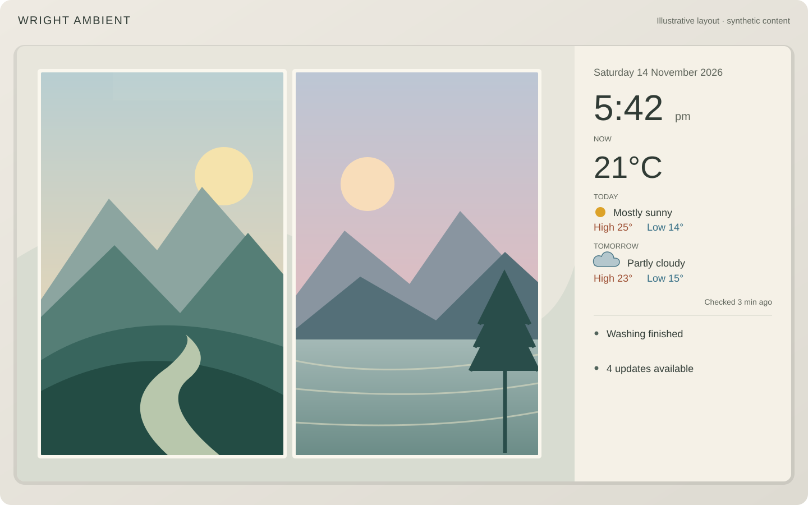
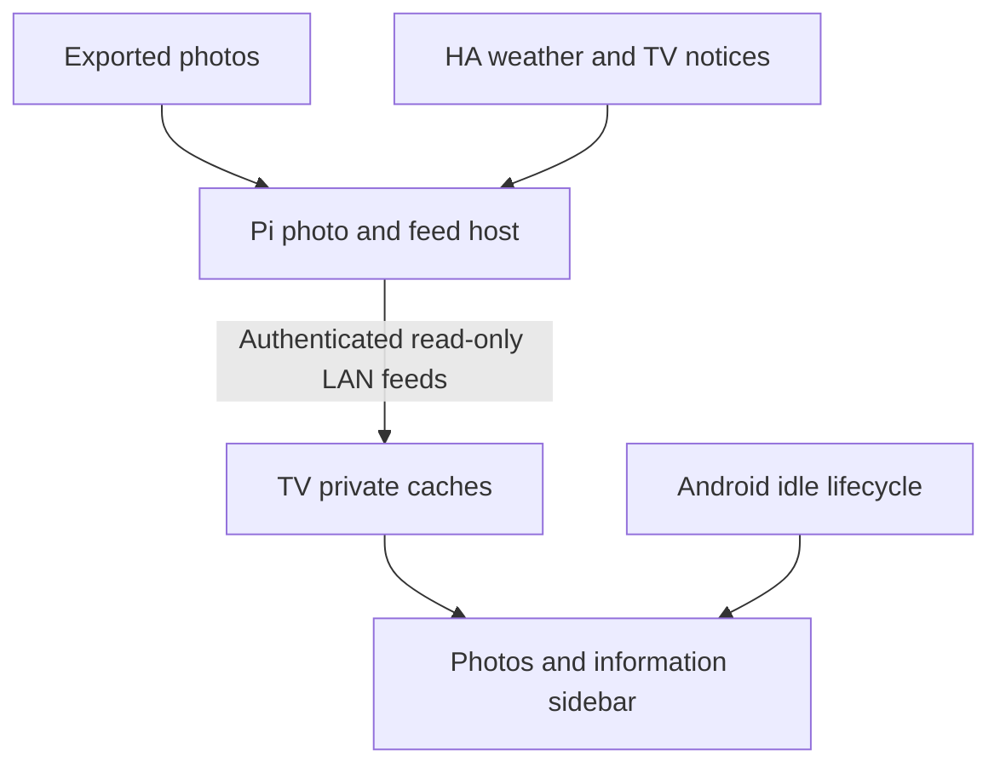

# Bravia Ambient Display

A native Android screensaver that puts family photos, weather and useful household
notices on a Sony Bravia TV. A small Raspberry Pi host supplies authenticated LAN
feeds; Android controls when the screensaver starts and stops.

Built for a real household: complete photos, a quiet information sidebar, and a
remote button to return to normal TV use.



*Illustration using synthetic images and data, not a household photo or device screenshot.*

## What it does

- Fits whole images, pairs consecutive portraits when suitable, and remembers
  the next photo across sessions in a fixed album order.
- Shows local date/time, observed temperature, separate Today/Tomorrow forecasts
  and honest check-age wording. The household uses BOM weather through HA.
- Shows up to three HA-approved notice rows, grouped updates and an overflow
  count. Timed messages expire; last-known faults remain visible with a stale warning.
- Keeps complete local caches so a failed refresh does not erase a working display.
- Uses Android's DreamService lifecycle. Any remote input dismisses the display;
  notices cannot wake the TV, change inputs or interrupt viewing on command.

## Project status

The photo/weather/notice product is complete for the household's current needs.
Source review, installation and acceptance are separate records. This repository
remains private; there is no published APK release.

| Baseline | Recorded state on 14 November 2026 |
| --- | --- |
| Accepted `main` | `bddf067`: photos, weather and home-style layout; notices are not merged |
| Installed host | `37ce0ad`: photo/weather feed and corrected HA notice adapter |
| Installed TV | Android source `fc28daf`; photo/weather and both natural notice rows visually confirmed |
| Notice PR | [#8](https://github.com/lachlanw-117/Bravia-Ambient-Display/pull/8) remains open and unmerged at the owner's request |
| This refresh | Documentation and build checks only; no runtime deployment or device settings change |

The recorded device is a Sony X90K on Android 12, with a Pi 5 running HA OS.
Other models and firmware are not certified. Installed hashes, scoped acceptance
and limitations are in the [notice trial](HOUSEHOLD_ALERTS.md). ADB was explicitly
left enabled by the owner; ordinary operation does not require it.

## Architecture and design choices



| Decision | Practical effect |
| --- | --- |
| Native DreamService | OS-owned idle entry and exit; no boot receiver, competing idle timer or wake lock |
| Complete-image fitting | Foreground photos stay intact; portrait pairing preserves album order |
| Bounded transactional caches | Validated manifests and byte budgets constrain storage; failed refreshes retain a complete album |
| Separate Android workers | Photo sync, weather, notices and decoding do not share a blocking worker; host notice polling is independent too |
| HA-owned routing | TV gets a sanitised destination view, not a private inbox or device-control proxy |
| Private runtime state | Photos, credentials, signing material and caches stay outside source control |

See the [architecture guide](docs/architecture.md) for contracts and failure
behaviour, and [decision records](DECISIONS.md) for tradeoffs and superseded designs.

## Build and try it

Host checks need Node.js 22 or later and no npm dependencies:

```sh
npm test
npm run check:docs
node tools/package-addon.mjs
```

On Windows, with JDK 21 and Android API 35/build-tools 35.0.0 installed:

```powershell
./tools/build-android.ps1 -JavaHome $env:JAVA_HOME -SdkRoot $env:ANDROID_HOME -Unsigned
```

This creates `build/android/wright-ambient-unsigned.apk` without signing, installing
or contacting a device. The generated HA local-app package is `build/bravia_ambient/`.
See [getting started](docs/getting-started.md) for portable tools, local signing,
configuration and an approved installation.

Notices also require the companion [HA attention configuration](https://github.com/lachlanw-117/Wright-Home-Assistant/blob/feature/household-attention-handler/docs/household_attention.md).
The Bravia app alone does not supply household source rules.

## Validation and limits

The latest runtime record has **37 synthetic host tests and 278 JVM assertions**,
plus local Android build/signature checks and scoped household acceptance. The
workflows on this branch add local Markdown checks and an unsigned Android build;
those additions need a CI run after publication. Compilation is not Sony input testing.

Album maintenance uses manual exports, with no unattended Google Photos sync.
JPEG, PNG and WebP are supported: one album, 250 photos, 8 MiB per photo and
256 MiB total. HEIC/RAW/video need conversion or exclusion. LAN HTTP is unencrypted;
use a suitable existing HTTPS proxy where available and keep the host off the internet.

Full HDMI/app-specific behaviour, controlled outages, restart continuity and
real-TV notice overflow remain unverified scenarios. These are evidence limits,
not promised phases. Read [validation](VALIDATION.md) and [maintenance](MAINTENANCE.md).

## Contribution, assistance and attribution

Lachlan defined the household requirements and design choices and provided the
recorded household acceptance. Implementation and documentation used AI assistance.
Source, decisions, automated checks and scoped device observations provide the
evidence for claims here; AI assistance is not a substitute for review.

Project source is under [Apache-2.0](LICENSE). Android, Node.js and Home Assistant
are upstream platforms; provider attribution remains in the household weather feed.
This independent personal project has no Sony, Google or Home Assistant endorsement
and represents no employer or client work. See [contributing](CONTRIBUTING.md).

## Documentation and future direction

The [documentation index](docs/README.md) covers setup, architecture, validation,
operation and validation. For the optional journey, [design evolution](docs/design-evolution.md)
connects the key choices; detailed trials live in the [history archive](docs/history/README.md).
The [roadmap](ROADMAP.md) has one future concept:
a **separate aircraft-tracking screensaver**, requiring its own later plan.
