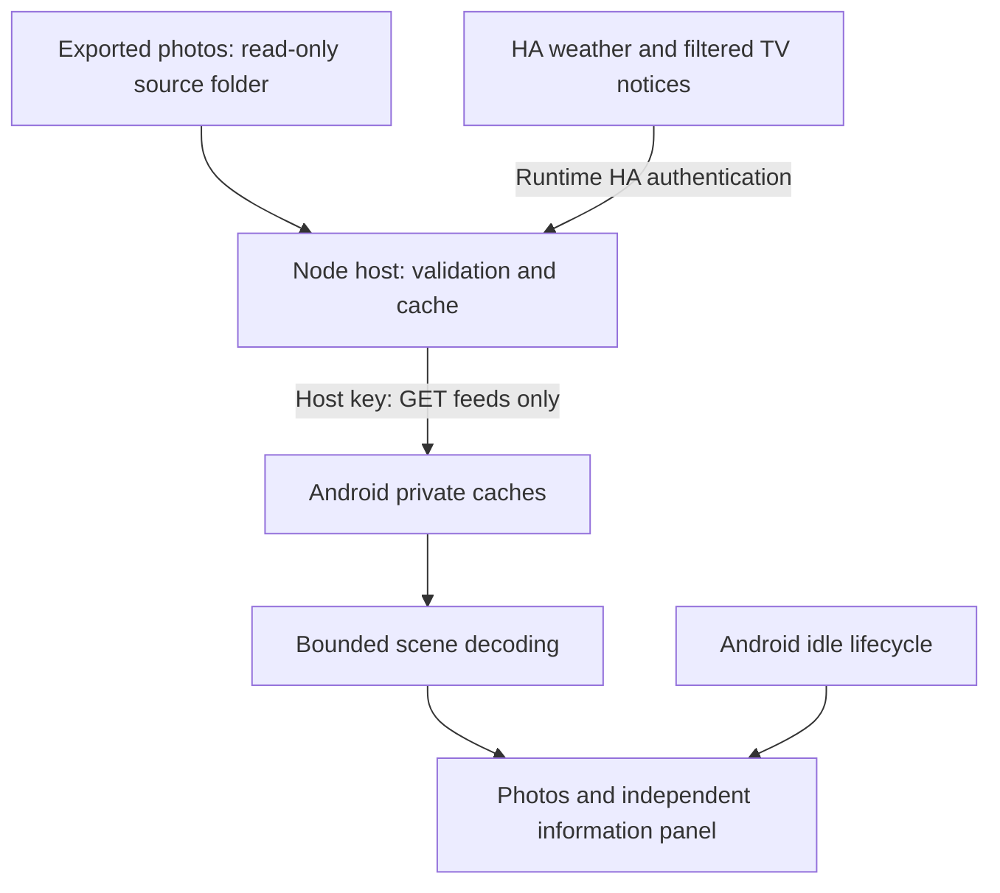

# Architecture

Two runtime components: a native Android DreamService and a Node.js host packaged
as an HA OS local app. Source definitions and routing stay in the
[companion HA repository](https://github.com/lachlanw-117/Wright-Home-Assistant).

## Responsibilities and trust boundaries

| Component | Owns | Does not own |
| --- | --- | --- |
| HA | Source meaning, lifecycle, destination switches, pauses and phone routing | Rendering and photo storage |
| Pi host | Photo validation/cache, weather normalisation, sanitised notices and authenticated feeds | Arbitrary HA proxying or device control |
| Android | Fitting, ordering/continuation, private caches and sidebar | Fault resolution or phone acknowledgement |
| Android OS | Idle entry, exit and Home/power behaviour | Album order or household routing |

HA authentication stays in the installed host. The TV stores the host key only.
Notice feeds omit raw evidence and phone metadata. HTTP on a trusted LAN is a
deployment tradeoff, not transport encryption.

## Photo pipeline

The host scans a manually maintained folder every five minutes. It validates
count, byte budgets and file type, hashes content for identity and publishes a
complete manifest. Missing/empty sources preserve the prior album; pruning does
not delete source photographs.

The TV verifies manifest bounds, lengths, hashes and image decoding before
replacing its cached manifest. Failed refreshes retain a complete album. Up to
two stored album generations can temporarily require roughly 512 MiB, while
current/incoming scene limits separately bound decoded bitmap memory.

Whole foreground images fit their rectangles without cropping. Consecutive
portraits pair where suitable; an unmatched portrait stays alone. Continuation
is recorded when a scene starts displaying. API 26-27 has an EXIF fallback;
recorded physical compatibility remains household-specific.

## Weather and notices

Android has separate photo, weather and notice workers, plus a decoder. Photos
and weather refresh on entry and every five minutes; notices every 15 seconds.
UI clock ticks are independent. Exit stops workers and cancels requests.

The host shares its photo/weather update path. Notice polling is a separate
15-second task and serving does not wait for album synchronisation/weather requests.
Weather observations and daily forecasts have distinct provenance. Today/Tomorrow
use local dates; a retained forecast low belongs to its provider, unit and date.
Missing values are not zero or another day's minimum. Attribution stays in the feed.

Notices come only from HA's already-filtered `sensor.household_attention_tv`.
The adapter requires ready state and schema 1 (number `1` or exact string `"1"`),
then validates bounded, allowlisted records. Invalid responses cannot clear a
snapshot. Upgrades are grouped with uncertainty retained. See the
[contract](../HOUSEHOLD_ALERTS.md#read-only-contract-and-freshness) for field/timestamp limits.

## Feed surface and failure behaviour

| GET route | Authentication | Purpose |
| --- | --- | --- |
| `/health` | None | Reachability only |
| `/manifest` | Host bearer key | Album metadata |
| `/photos/<content-id>` | Host bearer key | A photo declared by the manifest |
| `/weather` | Host bearer key | Observations, dated forecasts and freshness |
| `/notices` | Host bearer key | Sanitised TV notices and last retrieval time |

Other HTTP methods are rejected. There is no HA write/control route.

Both sides atomically retain the last valid notice snapshot. A successful empty
feed removes previous items; request failure does not. Faults remain until HA
clears/suppresses them. Timed events expire locally at HA's deadline even offline.
After two minutes without successful retrieval, the UI warns that notices may be
out of date. With no snapshot it says unavailable; a fresh empty view stays blank
rather than declaring the whole household healthy.

Pure Java policy and production host reducers are tested with synthetic data.
Android storage, graphics and Sony input need scoped device evidence. See
[validation](../VALIDATION.md), [decisions](../DECISIONS.md) and [trial results](../HOUSEHOLD_ALERTS.md).
